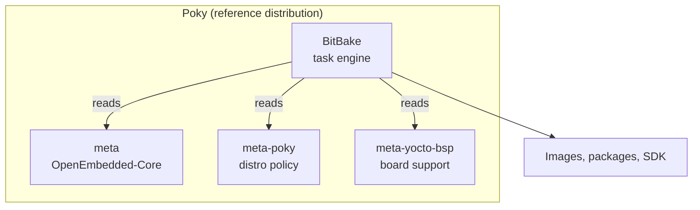

# 8.1 - Yocto Terminology

> Learn the vocabulary (Poky, metadata, OpenEmbedded, BitBake, BSP) that every other Yocto lesson uses.

| | |
|---|---|
| **Previous** | [8 - Yocto Project](../README.md) |
| **Next** | [8.2 - What to edit: recipes, configs, classes, layers](WhatToEdit.md) |

## How the pieces fit together

## Poky

Poky is the **reference distribution** of the Yocto Project ("reference" meaning "working example").
The Yocto Project uses Poky to build images (kernel, system and application software) for target hardware.

Technically, Poky is one repository that combines:

- **BitBake**
- **OpenEmbedded-Core** (the `meta` layer)
- **meta-poky** and **meta-yocto-bsp**
- Documentation

Poky contains **no binaries**: it is a working example of how to build your own Linux distribution from source.

### Yocto vs. Poky

**Yocto** is the project / organisation (like Canonical, the company behind Ubuntu);
**Poky** is the actual thing you download (like Ubuntu itself).

## Metadata

- **Outside Yocto:** data that describes other data.
- **In Yocto:** the build instructions. Commands and data that say which software versions to use,
  where to get them from, and which changes (**patches**) to apply to fix bugs or customise them.

Metadata is a collection of:

| File type | Extension |
|---|---|
| Configuration files | `.conf` |
| Recipes | `.bb`, `.bbappend` |
| Classes | `.bbclass` |
| Includes | `.inc` |

Each type is explained in [What to edit](WhatToEdit.md).

## OpenEmbedded

[OpenEmbedded](https://www.openembedded.org) offers a cross-compile environment to create a complete Linux
distribution for embedded systems.

### OpenEmbedded vs. the Yocto Project

Both share a core collection of metadata called **OpenEmbedded-Core (oe-core)**, but they remain separate
organisations with different focus:

| OpenEmbedded | Yocto Project |
|---|---|
| A broad set of metadata (e.g. `meta-openembedded`) for many architectures, features and applications | Easy-to-use, interoperable, well-tested tools, metadata and BSPs for a core set of architectures and boards |
| Not a reference distribution; designed as a foundation for others | Provides the reference distribution, Poky |

## BitBake

- The core build engine of the Yocto Project, similar in role to **make**.
- A **task scheduler** that parses mixed **Python** and **shell** code.
- Reads recipes and turns them into **tasks** (fetch, unpack, patch, compile, install...), ordered by their dependencies.
- Runs as many tasks in parallel as possible and tracks them all, so builds are fast and reproducible.

Commands are in the [BitBake cheat sheet](../bitbake/README.md).

## meta-yocto-bsp

A **Board Support Package (BSP)** is everything needed to support a particular **hardware device**, **set of
devices** or **platform**: hardware features, kernel configuration, extra drivers, and any additional
software components the board needs.

In the scarthgap release, `meta-yocto-bsp` supports these machines (see `meta-yocto-bsp/conf/machine/`):

| Machine | `MACHINE` value |
|---|---|
| BeagleBone Black | `beaglebone-yocto` |
| Generic 64-bit ARM (SystemReady) | `genericarm64` |
| Generic x86 PCs (32 / 64-bit) | `genericx86` / `genericx86-64` |

For other hardware, add the vendor's BSP layer (e.g. `meta-raspberrypi`, `meta-ti`).

## meta-poky

Poky-specific metadata: the **distro configuration** (`DISTRO = "poky"`) that sets default policies such as
the init system and package format.

## Summary

**Poky includes:**

- OpenEmbedded-Core (`meta`)
- BitBake
- Demo BSPs (`meta-yocto-bsp`)
- Helper scripts to set up the environment (`oe-init-build-env`)
- QEMU support to test images (`runqemu`)

## Exercises

1. In `poky/`, list the folders and match each one to a section of this page.
2. Run `bitbake-layers show-layers` in your build folder and identify which layer is the BSP and which is the distro layer.
