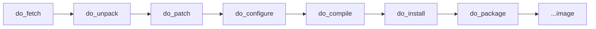

# 8.8 - Tasks

> See the tasks BitBake runs for a recipe, run them one at a time, and inspect what each produces.

| | |
|---|---|
| **Previous** | [8.7 - Your first recipe](../5-BuildRecipe/README.md) |
| **Next** | [BitBake cheat sheet](../bitbake/README.md) |

## Background

To build a recipe, BitBake runs a chain of **tasks**, each one using the output of the previous one:



| Task | Description |
|---|---|
| `do_fetch` | Fetches the source code (from `SRC_URI`) into `DL_DIR` |
| `do_unpack` | Unpacks the source code into the work directory |
| `do_patch` | Finds patch files and applies them to the source |
| `do_configure` | Configures the source: enables/disables build-time options |
| `do_compile` | Compiles the source in the build directory `B` |
| `do_install` | Copies the build results into the staging area `D` |

## Useful commands

```bash
# list every task of a recipe (printed in alphabetical order)
bitbake -c listtasks <recipe_name>

# run one task (and everything it depends on)
bitbake -c <task> <recipe_name>         # e.g. bitbake -c compile helloworld

# delete everything built and downloaded for a recipe
bitbake -c cleanall <recipe_name>
```

## Steps

### 1. Fetch

The fetch task downloads the source from local or remote locations listed in **`SRC_URI`**.
**`SRCREV`** selects a specific revision (commit hash) when fetching from git.

```bash
bitbake -c fetch <recipe_name>
```

The result is in the download folder (`DL_DIR`, set in `local.conf`).

### 2. Unpack

Unpacks what `do_fetch` downloaded into the recipe's work directory. To find it:

```bash
bitbake-getvar -r <recipe_name> WORKDIR
```

```bash
bitbake -c unpack <recipe_name>
```

Look inside `WORKDIR` (and `S`) to see the unpacked source.

### 3. Patch

Locates patch files and applies them to the source. It's optional and only does something if the recipe
lists patches. A patch describes explicit changes to one or more files.

Add patches to `SRC_URI`, usually from a `.bbappend` in your own layer:

```bash
SRC_URI += "file://0001-fix-something.patch"
```

```bash
bitbake -c patch <recipe_name>
```

### 4. Configure, compile, install

```bash
bitbake -c configure <recipe_name>
bitbake -c compile <recipe_name>
bitbake -c install <recipe_name>      # results under ${WORKDIR}/image (= D)
```

If a task fails, its log is in `${WORKDIR}/temp/log.do_<task>`, and the exact script BitBake ran is in
`${WORKDIR}/temp/run.do_<task>`.

## Exercises

1. Run `bitbake -c install helloworld` and find the binary under `image/usr/bin/` in the work directory.
2. Break `helloworld.c` on purpose, run `bitbake helloworld`, and read `temp/log.do_compile`.
