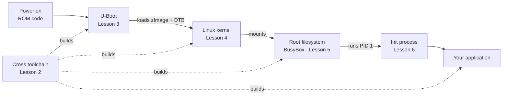

# Embedded Linux From Scratch

A hands-on course that builds a complete embedded Linux system **one piece at a time**:
first by hand (toolchain → bootloader → kernel → root filesystem → init), then with the
build systems used in industry (**Buildroot** and **Yocto**).

Every lesson can be followed on **QEMU** (no hardware needed), a **Raspberry Pi**, or a **BeagleBone Black**.

## The big picture

Each lesson builds one box of this boot chain. By the end you will have made every one of them yourself.



## Learning path

Follow the lessons in order: each one uses what the previous one produced.

| # | Lesson | You will build / learn | Output used later |
|---|---|---|---|
| 1 | [Libraries](1-Library/README.md) | Static vs. dynamic libraries, how linking works | Understanding of `.a` / `.so` on the target |
| 2 | [Cross toolchain (Crosstool-NG)](2-Crosstool_Ng/README.md) | Your own ARM cross compiler | `~/x-tools/<tuple>/bin/*-gcc` |
| 3 | [U-Boot](3-Uboot/README.md) | Bootloader, SD card layout, TFTP | `u-boot`, `sd.img` / SD card, TFTP server |
| 4 | [Linux kernel](4-kernel/README.md) | Configure, build and boot a kernel + device tree | `zImage`, `*.dtb` |
| 5 | [BusyBox root filesystem](5-Busybox/README.md) | A minimal rootfs over NFS, SD card and initramfs | `rootfs/` |
| 6 | [Init process](6-InitProcess/README.md) | BusyBox init, System V init, systemd services | A daemon started at boot |
| 7 | [Buildroot](7-BuildRoot/README.md) | The whole system built automatically, custom packages | `sdcard.img` |
| 8 | [Yocto Project](8-Yocto/README.md) | Layers, recipes, variables, tasks | A custom image + your own layer |

**Yocto sub-lessons** (in order):
[Terminology](8-Yocto/1-YoctoTerminology/README.md) ·
[What to edit](8-Yocto/1-YoctoTerminology/WhatToEdit.md) ·
[Build folder & config files](8-Yocto/2-FolderDescription/README.md) ·
[Layers](8-Yocto/3-Layer/README.md) ·
[Basic variables](8-Yocto/4-Variables/Basic_Variables.md) ·
[Variable assignment](8-Yocto/4-Variables/Variable_Assignment.md) ·
[Your first recipe](8-Yocto/5-BuildRecipe/README.md) ·
[Tasks](8-Yocto/6-TaskBuild/README.md) ·
[BitBake cheat sheet](8-Yocto/bitbake/README.md)

### Supporting topics

Read these whenever you need them; they are not part of the main path.

| Topic | Why it helps |
|---|---|
| [Vi editor](ViEditor/ViEditor.md) | Editing files on a target that has no other editor |
| [Git & GitHub](Github/Github.md) | Working with U-Boot, kernel and Yocto sources |
| [CMake](Cmake/01Overview.md) | Building applications (like the [init demo app](InitApp/)) for the target |

## Choose your board

You only need **one** of these. Each lesson has a section per board; skip the ones you don't use.

| Board | What you need | Good for |
|---|---|---|
| **QEMU vexpress-a9** (Cortex-A9) | Only your PC | Starting out, no risk of breaking hardware |
| **Raspberry Pi 3 / 4** | Pi, microSD card, USB-to-serial (3.3 V) cable | Real hardware, easy to find |
| **BeagleBone Black** (Cortex-A8) | BBB, microSD card, USB-to-serial (3.3 V) cable | Real hardware, very well documented |

> A serial console is essential on real hardware: U-Boot and the early kernel only talk over UART.

## Host setup

The lessons are written and tested for **Ubuntu 22.04 / 24.04** (a VM works). You need about
**100 GB** of free disk if you plan to do the Yocto lesson.

```bash
sudo apt update
sudo apt install -y build-essential git bc bison flex libssl-dev libncurses-dev \
    u-boot-tools qemu-system-arm device-tree-compiler \
    tftpd-hpa nfs-kernel-server cpio rsync wget unzip
```

Lessons that need more packages (Crosstool-NG, Buildroot, Yocto) list them at the top.

## Conventions used in every lesson

| Name | Meaning | Example |
|---|---|---|
| `CROSS_COMPILE` | Prefix of your cross compiler | `arm-cortexa9_neon-linux-gnueabihf-` |
| `ARCH` | Kernel / U-Boot architecture | `arm` (or `arm64` for 64-bit Pi) |
| `DISK` | Block device of the SD card (or loop device) | `/dev/mmcblk0`, `/dev/sdb`, `/dev/loop0` |
| Host IP | Your PC on the board network (TFTP / NFS server) | `192.168.0.1` |
| Target IP | The board | `192.168.0.100` |

- Commands run on your **host PC** unless the block starts with `# U-Boot prompt` or `# target shell`.
- Anything in `<angle brackets>` must be replaced with your own value.
- **Commands that erase disks are marked ⚠️.** Always double-check `DISK` with `lsblk` first.

Helper scripts used across lessons live in [`scripts/`](scripts/).

## Contributing

New lessons follow the [lesson template](LESSON_TEMPLATE.md) so every lesson has the same
structure: goal → prerequisites → steps → checkpoint → troubleshooting → exercises.
Found a broken command? Please open an issue or a pull request.
